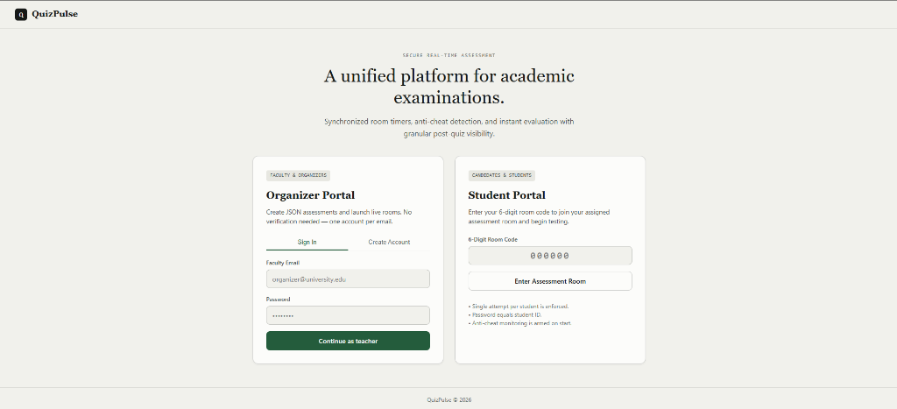
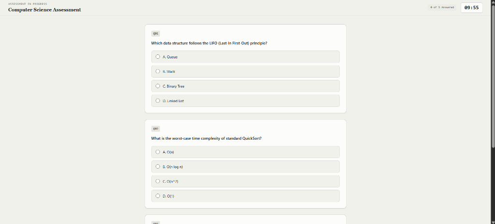
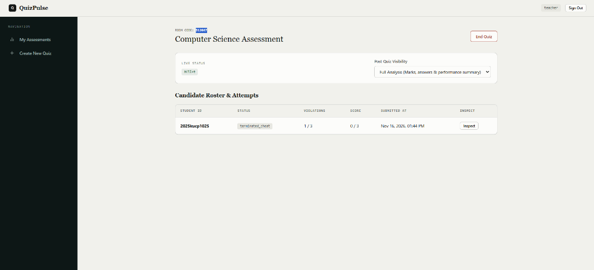
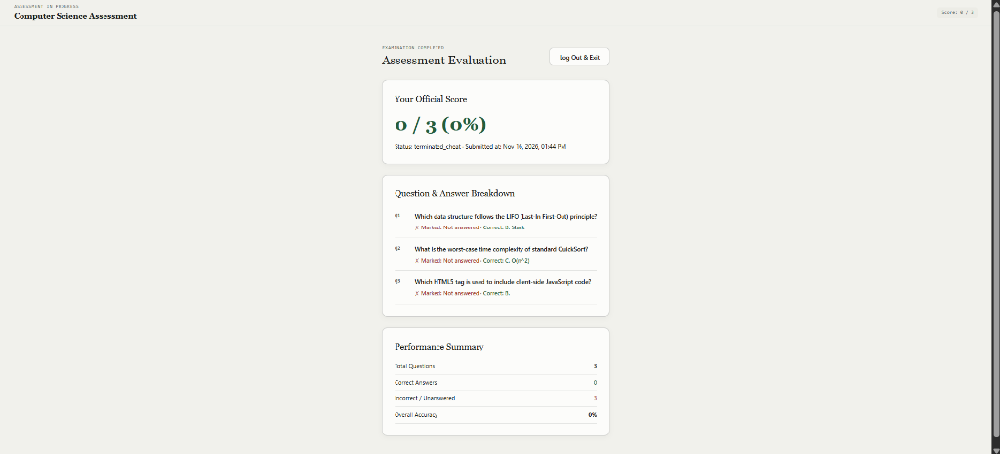

# QuizPulse — Real-Time Assessment Platform

QuizPulse is a lightweight, real-time examination and assessment platform built with vanilla **HTML5**, **CSS3**, and **JavaScript**, powered by a beginner-friendly **PHP (Procedural MySQLi)** backend and **MySQL** database running on **XAMPP**.

---

## Features

- **Organizer Studio**:
  - Create assessments using standardized JSON schema.
  - Built-in schema validator with syntax and key error feedback.
  - Real-time room control (**Start Quiz**, **End Quiz**) with synchronized 6-digit room codes.
  - Post-quiz visibility configuration:
    - `marks_only`: Candidate views official score only.
    - `marks_and_answers`: Candidate views score plus question-and-answer comparison.
    - `full_analysis`: Candidate views score, breakdown, and overall performance metrics.
  - Historical reports, class averages, question difficulty percentages, and candidate drill-downs.

- **Student Portal**:
  - Simple 6-digit room code check-in with single-attempt enforcement.
  - Synchronized waiting lobby with live entry window countdown (**Timer 1**).
  - Fullscreen examination view with live attempt duration timer (**Timer 2**).
  - Anti-cheat monitoring (detects tab switches, window blur, exiting fullscreen, right-click context menu, copy/paste attempts).
  - Autosaved question drafts to prevent data loss on accidental disconnects.
  - Immediate evaluation and breakdown based on organizer-configured visibility.

---

## Tech Stack

- **Frontend**: HTML5, CSS3, Vanilla JavaScript (Procedural style, `fetch()`, `async/await`)
- **Backend**: Plain PHP (Procedural style using the `mysqli` extension)
- **Database**: MySQL (Managed with phpMyAdmin on XAMPP)
- **Authentication & Sessions**: Built-in PHP Sessions (`$_SESSION`) with `password_hash()` and `password_verify()`

---

## File Structure

```text
Quiz-pulse/
├── index.html                   # Landing page (teacher login/signup & student code check)
├── teacher.html                 # Organizer dashboard, studio, live room & drill-downs
├── student.html                 # Candidate portal & synchronized waiting lobby
├── quiz.html                    # Candidate exam screen (fullscreen, timer, anti-cheat)
├── auth.js                      # Frontend JS: auth calls, fetch wrappers, statistical math
├── app.js                       # Frontend JS: active quiz runner, timers, options, autosave
├── database.sql                 # MySQL schema + tables + sample data for phpMyAdmin
├── README.md                    # Project documentation
├── screenshots/                 # Application preview screenshots
│   ├── landing-page.png
│   ├── exam-screen.png
│   ├── live-room.png
│   └── evaluation-results.png
└── php/                         # Backend PHP folder (Procedural MySQLi)
    ├── db.php                   # Database connection ($conn) & session_start()
    ├── signup.php               # Teacher registration (password_hash)
    ├── login.php                # Teacher login (password_verify)
    ├── student_login.php        # Candidate check-in & single attempt enforcement
    ├── logout.php               # Clears $_SESSION and expires session cookies
    ├── check_login.php          # Session verification & route guard
    ├── create_quiz.php          # Saves new assessment and questions into MySQL
    ├── get_quizzes.php          # Lists quizzes for teacher dashboard
    ├── get_quiz_by_code.php     # Fetches quiz metadata, roster, and submissions
    ├── get_questions.php        # Delivers exam questions without leaking answers
    ├── update_status.php        # Room control: 'waiting' -> 'active' -> 'ended'
    ├── update_visibility.php    # Real-time results visibility setting
    ├── save_draft.php           # Real-time autosave of in-progress candidate answers
    ├── record_violation.php     # Anti-cheat strike counter (tab switch, blur, etc.)
    ├── save_result.php          # Grades quiz server-side and locks submission
    ├── purge_session.php        # Purges candidate session and blocks re-entry
    ├── get_past_results.php     # Candidate drill-down analysis
    └── get_analysis.php         # Class averages and question difficulty percentages
```

---

## Screenshots

### 1. Landing & Authentication Portal


### 2. Candidate Examination View


### 3. Organizer Live Room & Real-Time Roster


### 4. Assessment Evaluation & Results Breakdown


---

## License

MIT License &copy; 2026 QuizPulse
